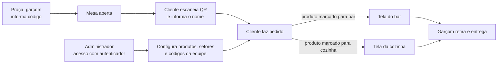

# Proposta para discussão: operação do Vamo Rachar

**Situação:** backend experimental implementado e testado na branch `proposta-fluxo-equipe`; ainda não aprovado para a main nem implantado no Render. O GitHub Actions passou, conforme confirmação de Luciano.
**Responsável pela visão do produto:** Luciano
**Preparação:** 28/10/2026
**Objetivo:** apresentar como serão acessados o administrador, a praça, o bar e a cozinha e quais mudanças serão necessárias no backend.

Este documento registra uma proposta em uma branch separada. A implementação presente na `main` continua sendo a referência técnica atual até que a equipe aprove eventuais alterações.

## 1. Ideia central

O restaurante usa telas compartilhadas. A equipe não precisa fazer login individual com e-mail e senha em cada tela de operação. O administrador configura o estabelecimento em uma área protegida com autenticador. Cada garçom ou gerente recebe um código individual, criado no administrador e informado em ações que exigem identificação e autorização, como abrir mesa e cancelar pedido.

O cliente escaneia o QR de uma mesa aberta, informa seu nome e faz pedidos. O administrador define se cada produto deve ser preparado pelo bar, pela cozinha ou pelos dois. Os setores atualizam o andamento e o garçom faz a retirada e entrega.

## 2. Papéis e telas

| Tela ou pessoa | Finalidade | Acesso previsto |
| --- | --- | --- |
| Administrador | Configurar produtos, preços, nomes, fotos, setores, disponibilidade e códigos da equipe | Firebase Authentication com verificação em duas etapas |
| Praça/garçom | Abrir mesas, acompanhar a operação, retirar e entregar; solicitar cancelamentos autorizados | Tela compartilhada; código individual nas ações que exigem identificação |
| Bar | Ver produtos enviados ao bar e atualizar seu preparo | Tela compartilhada ativada pelo gerente com código; preparo sem login individual |
| Cozinha | Ver produtos enviados à cozinha e atualizar seu preparo | Tela compartilhada ativada pelo gerente com código; preparo sem login individual |
| Cliente | Entrar em mesa aberta, consultar cardápio, pedir, dividir e fechar sua comanda | QR e nome; identidade técnica anônima pode ser usada sem cadastro |
| Gerente | Executar ações conforme suas permissões, inclusive cancelamentos autorizados | Código individual criado no administrador |

O acesso administrativo exige identidade Firebase com segundo fator e vínculo administrativo ativo. Cada tela compartilhada é ativada por um gerente com seu código e fica vinculada à identidade técnica do dispositivo. Na implementação experimental, a ativação dura 12 horas e pode ser revogada pelo administrador; esse prazo ainda será avaliado.

## 3. Fluxo do administrador

1. A pessoa responsável abre a área administrativa usando o **autenticador** previsto para o sistema.
2. Ela cadastra ou altera um produto: nome, descrição quando necessária, preço, foto e disponibilidade.
3. Marca as caixas **Bar**, **Cozinha** ou ambas, conforme a operação daquele produto.
4. Pode abrir ou fechar a disponibilidade do produto. Produto indisponível não deve ser aceito em novos pedidos.
5. Cria, desativa ou substitui códigos individuais de garçons e gerentes, associando-os às permissões autorizadas.
6. A API valida as operações administrativas e mantém histórico das alterações relevantes.

**Autenticador:** Luciano escolheu Firebase Authentication com verificação em duas etapas. Ainda é necessário validar o método de segundo fator, a disponibilidade no plano gratuito e como provisionar e recuperar o acesso administrativo.

**Foto:** a forma de armazenamento, os limites e as permissões de acesso ainda precisam ser escolhidos. Não pressupor um serviço pago para o protótipo.

### Exemplo de cadastro

| Produto | Preço de exemplo | Bar | Cozinha | Resultado |
| --- | ---: | --- | --- | --- |
| Coca-Cola | R$ 8,00 | Marcado | Desmarcado | Entra na fila do bar |
| Hambúrguer | R$ 32,00 | Desmarcado | Marcado | Entra na fila da cozinha |
| Produto preparado pelos dois setores | R$ 30,00 | Marcado | Marcado | Aparece nas duas filas, com um único valor na comanda |

Os valores são apenas exemplos. Na implementação experimental, o cadastro exige pelo menos um setor. Preço e destinos são registrados no momento do pedido; alterações posteriores no cardápio não alteram o item já criado.

## 4. Abertura da mesa e entrada do cliente

1. O garçom seleciona uma mesa disponível na tela da praça.
2. Informa seu **código individual**.
3. O servidor confere o código, a permissão, o estabelecimento e se a mesa já está ocupada.
4. A API abre uma nova sessão e registra o responsável e o horário. A mesa física continua sendo a mesma; cada ocupação recebe uma sessão própria.
5. O cliente escaneia o QR da mesa, informa o nome e entra na sessão aberta. Não há cadastro inicial obrigatório para o cliente.
6. O cliente consulta o cardápio disponível e vê os demais participantes da sessão para convidá-los a dividir itens.

A identidade anônima usada tecnicamente pelo Firebase não exige que o cliente crie login. A recuperação ao trocar de aparelho ainda precisa ser definida.

**Ponto importante para o piloto:** um QR estático pode ser fotografado e compartilhado, permitindo entrada à distância. A solução foi adiada e deverá ser decidida antes de operar em restaurantes.

## 5. Pedido, divisão e preparo

1. O cliente escolhe produto, quantidade e observações.
2. O servidor consulta o cardápio e valida disponibilidade, preço e setores. O cliente não determina esses valores.
3. No consumo individual, o item confirmado segue para os setores cadastrados.
4. Em item compartilhado, o iniciador escolhe participantes da mesma sessão. Cada convidado vê o preço integral e sua parcela em centavos e aceita ou recusa.
5. O item só é encaminhado para preparo depois que todos os convidados aceitam. Se alguém recusar, o iniciador pode cancelar, assumir ou propor outra divisão.
6. Bar e cozinha veem somente suas respectivas filas e atualizam o próprio andamento.
7. Ao ficar pronto, o item ou destino pronto fica disponível para acompanhamento pelo garçom, que registra retirada e entrega.

### Produto enviado aos dois setores

A implementação na branch cria um registro de andamento **por setor**. Se o bar ficar pronto antes da cozinha, sua situação deve poder ser acompanhada sem marcar a parte da cozinha como pronta. O item continua sendo um único consumo na comanda e não pode ser cobrado duas vezes.

**Decisão:** o garçom pode retirar e entregar cada parte separadamente. Ainda é preciso definir a apresentação na tela e a solução para indisponibilidade de apenas um dos setores.

## 6. Cancelamento na praça

1. Na tela da praça, a equipe seleciona o pedido ou item e aciona **Cancelar**.
2. O sistema solicita o código de um **garçom ou gerente autorizado**.
3. A API verifica o código, o estabelecimento, a permissão e o estado atual do item.
4. Se permitido, registra a ação, o responsável e o horário, e informa os setores afetados.
5. O histórico do pedido e os lançamentos financeiros devem ser preservados; um cancelamento não pode apagar pagamentos ou ajustes anteriores.

**Implementado na branch:** antes do preparo, garçom ou gerente autorizado pode cancelar; após seu início ou após entrega, somente gerente. O cancelamento é por item, exige motivo, registra o responsável e atualiza as filas. Se houver participante com pagamento pendente ou confirmado, o cancelamento é bloqueado para revisão; estornos e ajustes ainda não foram implementados.

## 7. Comanda e pagamento

- Cada participante tem sua comanda, inclusive as parcelas que aceitou de itens compartilhados.
- Os 10% de serviço são opcionais por pessoa e aparecem separadamente.
- A mesa continua aberta enquanto houver outras pessoas ou pendências.
- No fluxo desejado, o cliente envia um comprovante e a equipe confere o recebimento no canal financeiro do restaurante antes de autorizar a baixa. O envio da imagem, sozinho, não comprova pagamento.
- A decisão de quais ações de conferência exigirão código e quais papéis poderão autorizá-las ficará para a equipe.

Hoje a tentativa de pagamento, a análise, a saída e o encerramento existem **apenas como simulação nos emuladores**. A API do Render ainda não expõe essas operações, e o envio real de comprovante, provedor, estorno e conciliação não estão implementados.

## 8. Segurança dos códigos e da área administrativa

O código de funcionário é uma **credencial secreta**, não um CPF real nem apenas um identificador público. Para o backend:

- Criar, alterar, desativar e recuperar códigos por um procedimento administrativo autorizado.
- Validar no servidor o código e a permissão para a ação e para o estabelecimento corretos.
- Não guardar o código em texto puro nem colocá-lo em URLs ou logs. A API retorna o código somente uma vez ao administrador, no momento da criação ou troca; ele deve ser mostrado e entregue ao funcionário de forma segura.
- Prever bloqueio ou limitação de tentativas, auditoria e troca quando houver suspeita de exposição.
- Registrar quem realizou ações sensíveis sem registrar o código informado.
- Proteger as telas e os dispositivos compartilhados, além de definir a autenticação do administrador.

Luciano escolheu que o gerente ative cada dispositivo compartilhado com seu código. Nesta implementação inicial, a ativação dura 12 horas e os códigos têm oito dígitos; esses parâmetros e o procedimento de recuperação ainda devem ser avaliados. Esses detalhes devem ser definidos e testados antes do piloto.

## 9. Comparação com o backend atual

| Tema | Situação na `main` | Trabalho necessário para a proposta |
| --- | --- | --- |
| Equipe | Endpoints exigem identidade Firebase e papéis da equipe | Adaptar identificação/autorização por código nas ações definidas e proteger dispositivos compartilhados |
| Administrador | Não há fluxo administrativo completo | Definir acesso por autenticador e criar operações gerenciais autorizadas |
| Produto | Um campo `sector`: `bar` ou `kitchen` | Modelar seleção dos dois destinos e migrar dados existentes sem perder histórico |
| Fila e entrega | Uma fila e um estado por item | Registrar andamento de cada setor e definir retirada/entrega parcial |
| Cancelamento | Não há fluxo de cancelamento operacional | Implementar regras, permissão por código, histórico e efeitos financeiros |
| Dados de teste | O seed criado pelo Jean prepara restaurante, mesas, equipe e produtos | Revisar senha padrão, alterações em dados existentes e reutilização de sessão antes de executar em Firebase real |
| Pagamento | Simulação só nos emuladores | Definir simulação HTTP e depois armazenamento e validação real do comprovante |

O cliente, as regras de divisão, a comanda individual e o trabalho já existente serão aproveitados quando compatíveis com a decisão da equipe. A arquitetura, os contratos e os testes ainda precisam evoluir. Esta branch contém uma implementação parcial descrita em [implementacao-fluxo-proposta.md](implementacao-fluxo-proposta.md).

## 10. Etapas propostas se a equipe aprovar

1. **Revisar a implementação da branch:** produtos por setor, códigos, dispositivos, abertura, cancelamento e seed apenas de emulador foram implementados e testados localmente.
2. **Validar segurança e custos:** confirmar o segundo fator real no plano Firebase, o primeiro administrador, recuperação, segredos e proteção das telas.
3. **Concluir regras pendentes:** indisponibilidade parcial, cancelamento após pagamento, expiração dos códigos e demais permissões.
4. **Planejar migração e testar no Render:** preservar dados existentes e testar fluxos com dados fictícios, depois da aprovação.
5. **Desenhar e implementar as telas** após os protótipos aprovados no Figma; evoluir a simulação de pagamento e depois a conferência de comprovantes.

Cada etapa deve ter contrato de API e testes de sucesso, permissão negada, repetição de requisição, isolamento entre restaurantes e concorrência quando aplicável. Mudanças só devem chegar à `main` após avaliação da equipe e verificações aprovadas.

## 11. Perguntas para a reunião

1. Como será configurado o segundo fator do Firebase para o administrador e como será feita a recuperação do acesso?
2. Quais ações além de abrir mesa e cancelar precisam do código individual? A ativação pelo gerente durará quanto tempo?
3. Como tratar cancelamentos com pagamentos já confirmados, incluindo estornos e ajustes?
4. Como tratar uma parte indisponível de um produto enviado ao bar e à cozinha?
5. O código para conferir pagamento será de garçom, gerente ou de uma permissão específica?
6. Quais regras de reingresso, encerramento e cancelamento serão adotadas no protótipo?

## 12. Fora do escopo desta proposta

Nenhum serviço pago, implantação, integração com PDV ou cobrança real é criado por esta documentação. Render e Firebase gratuitos seguem destinados à prototipação; a hospedagem para restaurantes será decidida mais adiante. A possibilidade de Supabase também fica para uma decisão futura.
